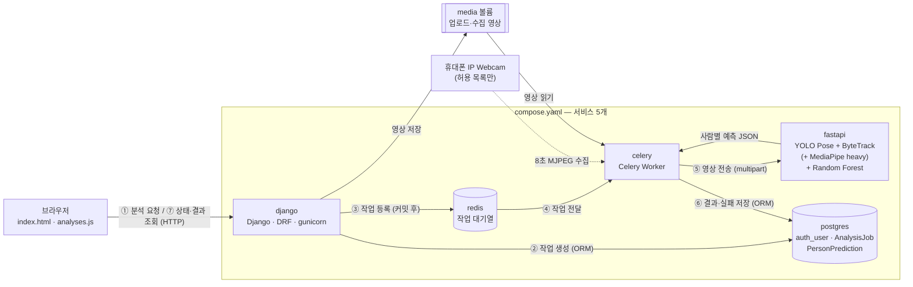
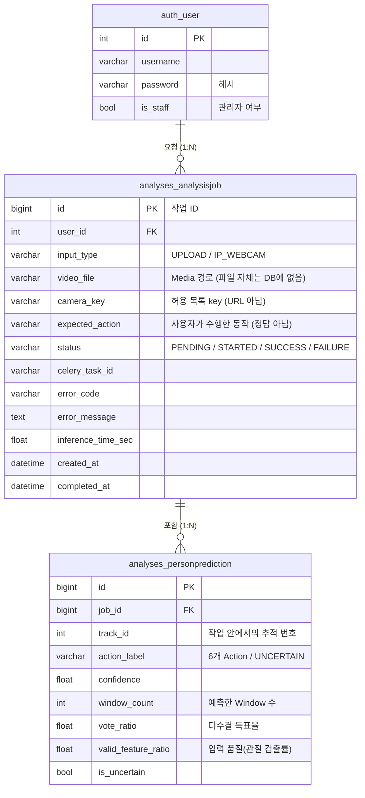
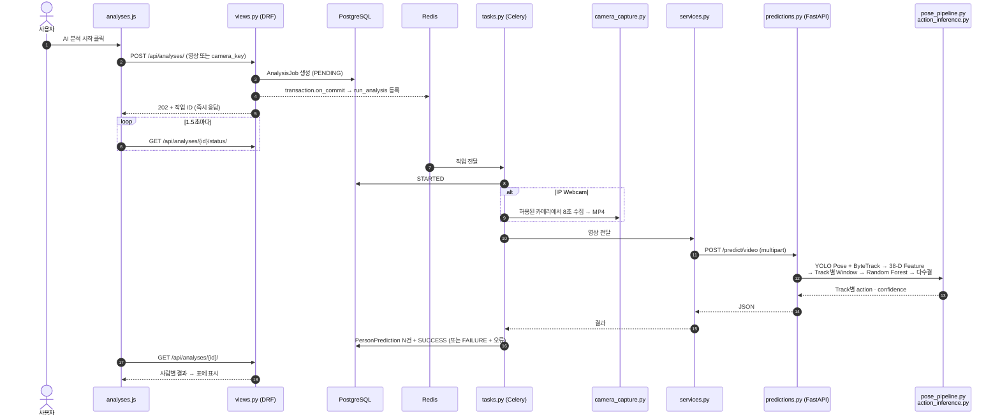
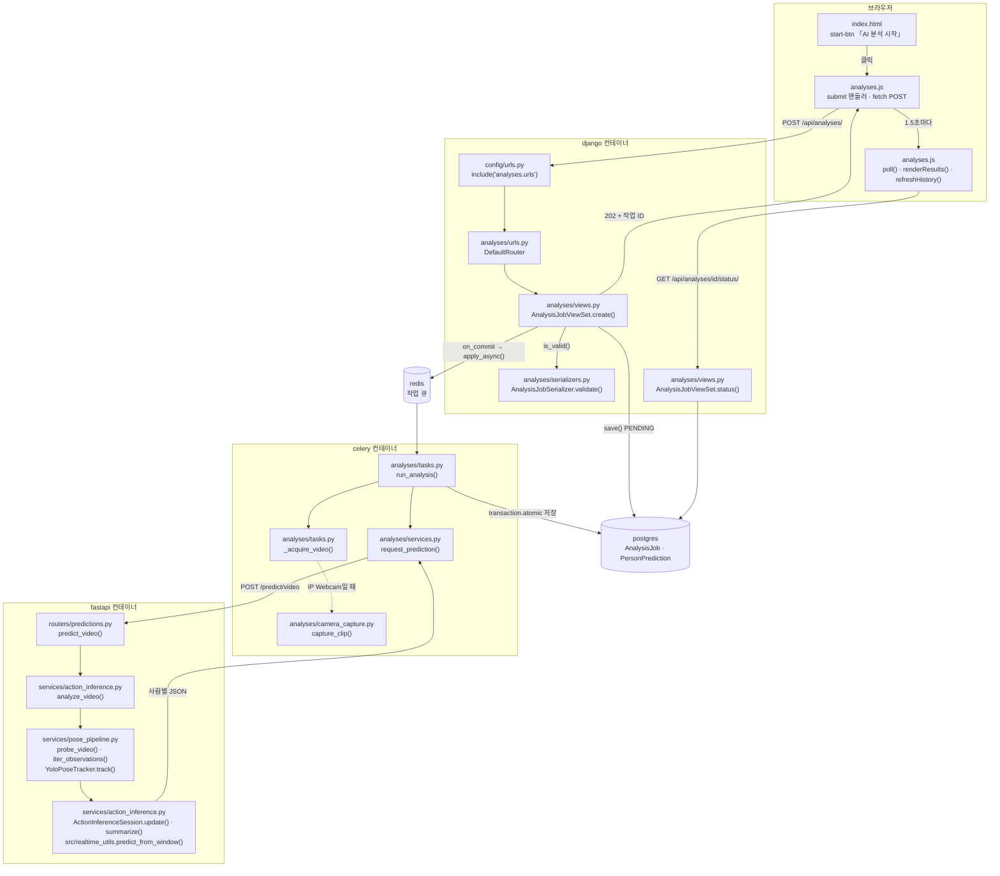
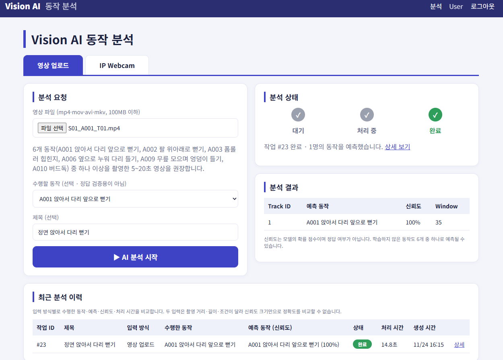
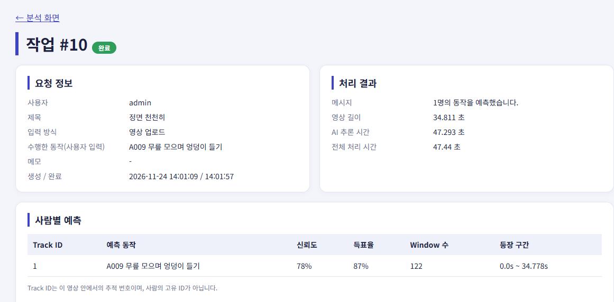
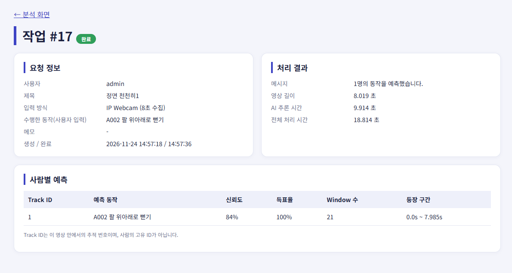

# Vision Action Platform — 6개 동작 인식 모델 기반 Vision AI 웹 서비스

> 교과10 최종 자율 프로젝트 · 1~8일차의 Pose·Feature·Window·Tracking 코드와 Random Forest 모델 형식을 그대로 가져와, 브라우저에서 분석을 요청하고 결과를 DB에 저장·조회하는 서비스
>
> 제출본은 발표 직전 tag `v1.0-submission`으로 고정합니다. 이후 커밋은 제출 후 개선입니다.

> **현재 범위 (4팀, `feat/async-minimal`)**: backend는 **로그인 없이 작업 요청·결과 조회만** 제공합니다.
> 회원가입·Admin·대시보드·화면(templates/static)·수정·삭제는 제거했고, 아래 본문 중 이 기능을 설명하는 부분은 정리 전 내용입니다.
>
> | API | 용도 |
> |---|---|
> | `POST /api/analyses/` | `input_type`=`UPLOAD`(+`video_file`) 또는 `IP_WEBCAM`(+`camera_key`) → **202** `{id, task_id, status, status_url, detail_url}` |
> | `GET /api/analyses/` | 작업 목록 (최신순, 20개씩) |
> | `GET /api/analyses/{id}/` | 상세: 입력 방식, 상태, 처리 시간, `predictions[]`(track_id, action_label, confidence, window_count, first/last_seen_sec …) |
> | `GET /api/analyses/{id}/status/` | 폴링용 `{id, status, done, error_code, error_message, result_message}` |
> | `GET /api/cameras/` | 허용 카메라 `key`·`label` (주소는 숨김) |
>
> 모든 주소는 `/api/v1/...` 로도 열립니다. 인증이 없으므로 CSRF 토큰도 필요 없습니다.

---

## 1. 프로젝트 소개

회원이 **영상 업로드** 또는 **IP Webcam(8초 수집)** 으로 분석을 요청하면, 영상 속 사람을 Track ID로 구분해 **사람별 동작(6개 중 하나)과 신뢰도**를 보여 주는 서비스입니다.
분석은 Celery로 비동기 처리하므로 요청 즉시 작업 ID를 받고, 화면에서 `대기 → 처리 중 → 완료/실패`를 확인합니다. 관리자는 Django Admin과 `/dashboard/` 차트로 전체 기록을 봅니다.

모델은 `bash scripts/switch_model.sh <모드>` 한 줄로 바꿀 수 있고, 서비스 코드는 모든 모드에서 같습니다.

| 모드 | 동작 | 모델 | 용도 |
|---|---|---|---|
| **`basic` (시연 기본)** | 과제 기본 6개: `bend_return` 허리 굽혔다 펴기 · `leg_raise_lower` 다리 들었다 내리기 · `walk_turn_walk` 걷다가 방향 바꾸기 · `drink_return` 음료 마시기 · `sit_stand` 앉았다 일어나기 · `wave` 손 흔들기 | 6일차와 같은 강사 제공 18클립·같은 Feature 규격, 학습 샘플만 Window 방식으로 늘린 v2 | 평가 기준 동작으로 시연 |
| `day06` | 위와 같음 | 6일차 `rf_action_baseline.joblib` **수정 없이** | 과제 원칙(재학습 없이 재사용) 확인 |
| **`team`** | 팀 재활 3개: A001 앉아서 다리 앞으로 뻗기 · A002 팔 위아래로 뻗기 · A006 옆으로 누워 다리 들기 | 팀원이 팀 영상 48개(3명)로 학습한 모델, MediaPipe heavy 관절 | 팀 주제(재활 운동) 시연 |
| `team6` (확장 실험) | 팀 3개 + A003 폼롤러 힙힌지 · A009 무릎 모으며 엉덩이 들기 · A010 버드독 | 11/17 추가 촬영 40개를 더해 다시 학습 | 같은 규격으로 동작을 늘릴 수 있는지 실험 |

> **과제 원칙과의 관계.** 과제의 기본 원칙은 "6일차 모델을 재학습 없이 재사용"입니다. 이 서비스는 6일차 산출물(`joblib` + Feature 순서 + 학습 정보)을 그대로 읽어 동작하며(`day06` 모드), 그 결과 **모든 예측이 신뢰도 0.21~0.32로 '판단 불확실'** 이 되는 것을 확인했습니다 (6장). 원인이 '클립 6개 → 샘플 6개'라는 학습 방식에 있어서, **같은 강사 제공 데이터·같은 Feature 규격**으로 샘플만 늘린 `basic`(v2)으로 시연합니다. 팀 모델들도 같은 규격이라 파일 3개와 `.env`만 바꾸면 됩니다.

> 예측 Label은 정답이 아닙니다. 학습하지 않은 동작도 6개 중 하나로 예측될 수 있으므로 Confidence·득표율과 함께 표시하고, 모든 Window가 기준 미만이면 `판단 불확실`로 표시합니다.

---

## 2. 실행 방법

### 2-1. 모델·기존 코드 준비 (재학습 없음)

```bash
# WSL, 이 저장소 루트에서
bash scripts/import_from_subject10.sh ~/ai_vision/subject10_pose_action
```

| 복사 대상 | 출처(기존 프로젝트) | 위치 |
|---|---|---|
| `rf_action_baseline.joblib`, `rf_feature_columns.json`, `rf_training_info.json` | `artifacts/day06/` | `ai_service/models/` |
| YOLO Pose 가중치 (`project.json`의 `pose_model`) | 프로젝트 내 `.pt` | `ai_service/models/` |
| `project.json`, `day07_realtime.json`, `day08_multi_person.json` | `configs/` | `ai_service/configs/` |
| `src/` 전체 (`multi_person_utils`, `realtime_utils`, `feature_utils` 등) | `src/` | `ai_service/src/` |

`team`·`team6` 모드는 위에 더해 아래 파일이 필요합니다 (팀 공유 드라이브에서 받거나 `ai_service/training/`의 스크립트로 다시 만듦).

| 파일 | 위치 |
|---|---|
| 팀 3동작: `rf_action_team.joblib`, `rf_feature_columns.json`, `rf_training_info.json` | `ai_service/models/team/backup_3actions/` |
| 확장 6동작: 같은 이름 3개 + `cv_report.json` | `ai_service/models/team/` |
| MediaPipe `pose_landmarker_heavy.task` | `ai_service/models/` |

모델·가중치는 용량이 크고 다시 만들 수 있는 산출물이라 **Git에 올리지 않습니다** (`.gitignore`). `compose.yaml`에서 `/app/models`로 읽기 전용 마운트합니다.

### 2-1-1. 모델 교체 방법 (팀원이 새로 학습한 모델로 바꿀 때)

서비스는 6일차 `35_train_rf_baseline.py` 산출물 형식을 그대로 읽으므로 **파일 3개만 교체**하면 된다.

```bash
cp <새 모델 폴더>/rf_action_baseline.joblib <새 모델 폴더>/rf_feature_columns.json <새 모델 폴더>/rf_training_info.json ai_service/models/
docker compose restart fastapi
docker compose exec fastapi python scripts/check_artifacts.py --with-pose   # T01
```

| 바뀌어도 되는 것 | 바뀌면 안 되는 것 |
|---|---|
| 학습 데이터 양·사람 수, `sequence_steps`, 트리 개수 등 모델 설정 | Frame당 38개 Feature 정의(17 Keypoint x·y + 관절각 4)와 순서. Class 이름은 `action_catalog.py`·`model_loader.py`의 `ACTION_SETS`에 있어야 함 |

- 규격이 다르면 `check_artifacts.py`(T01)와 서버 시작 단계에서 원인을 출력하고, 모델을 '준비 안 됨'으로 두어 예측 요청을 503으로 거절한다 (틀린 예측을 내지 않음, `/health`에 원인 표시).
- 학습 환경의 scikit-learn 버전이 다르면 `.env`의 `SKLEARN_VERSION`을 맞추고 `docker compose up --build -d`.

### 2-2. 환경변수

```bash
cp .env.example .env
# .env 에서 수정할 것
#  - DJANGO_SECRET_KEY, POSTGRES_PASSWORD
#  - IP_WEBCAMS=phone1|내 휴대폰|http://<휴대폰 IP>:8080/video
#  - PYTHON_VERSION / SKLEARN_VERSION / ULTRALYTICS_VERSION  ← import 스크립트가 출력한 학습 환경 버전
```

### 2-3. 실행

```bash
docker compose up --build -d                        # 5개 서비스 실행 (django가 migrate 자동 수행)
docker compose exec fastapi python scripts/check_artifacts.py --with-pose   # T01 모델 확인
docker compose exec django python manage.py createsuperuser                 # 관리자 계정
docker compose ps                                   # fastapi가 healthy 가 될 때까지 대기 (모델 로딩)
```

| 화면 · API | 주소 (기본 포트 8000/8001, 다른 프로젝트와 겹치면 `.env`의 `DJANGO_HOST_PORT`·`FASTAPI_HOST_PORT`로 변경) |
|---|---|
| 사용자 분석 화면 | http://localhost:8000/analyses/ (`/`는 여기로 이동) |
| 회원가입 · 로그인 | http://localhost:8000/accounts/signup/ · /accounts/login/ |
| 관리자 대시보드 | http://localhost:8000/dashboard/ |
| Django Admin | http://localhost:8000/admin/ |
| 분석 작업 API | `/api/analyses/` = `/api/v1/analyses/` (두 주소 모두 지원) |
| FastAPI Swagger UI (이 PC에서만) | http://127.0.0.1:8001/docs |
| FastAPI 영상 추론 | `POST /predict/video` = `POST /api/v1/predict/` |

> API 주소는 과제 문서(`/api/analyses/`, `/predict/video`)와 9~10일차 단계별 개발 가이드의 권장 주소(`/api/v1/...`)를 모두 지원한다. 작업 상태 표기는 과제 문서 기준 `PENDING → STARTED → SUCCESS / FAILURE`로 통일했다.

### 2-4. 테스트

```bash
docker compose exec django python manage.py test          # 회원·권한·CRUD·Celery 작업·화면·동작 목록 (34개)
cd ai_service && pip install pytest httpx scikit-learn && python -m pytest tests   # 추론 API·모델 로더·관절 보정 (19개, YOLO 대신 가짜 Tracker)
```

---

## 3. 전체 아키텍처



| 서비스 | 맡은 일 | 하지 않는 일 |
|---|---|---|
| **django** | 회원, CRUD API, 작업 생성·상태 조회, Admin, 대시보드 | AI 추론, 모델 학습 |
| **celery** | 영상 확보(업로드 파일 / 카메라 8초 수집) → FastAPI 호출 → ORM 저장 | 화면 렌더링 |
| **fastapi** | 영상 → 사람별 Action JSON (`/health`, `/predict/video`) | DB 접근, 회원 관리 |
| **redis** | Celery 브로커·작업 상태 | 영구 업무 데이터 저장 |
| **postgres** | 사용자·작업·사람별 예측 영구 저장 (`pgdata` 볼륨) | — |

- 컨테이너 사이 통신은 `localhost`가 아니라 **서비스 이름**(`http://fastapi:8000`, `postgres`, `redis`)을 쓴다.
- 공개 포트: `django`만 `8000`으로 공개. `fastapi`는 개발 중 `/docs` 확인용으로 `127.0.0.1:8001`에만 연다. `postgres`·`redis`는 공개하지 않는다.
- FastAPI는 볼륨을 공유하지 않고 **영상 파일을 multipart로 받는다** → DB·파일 저장소를 모르는 독립 추론 서비스로 유지된다.

---

## 4. DB 설계 (ERD)



| 테이블 | 저장하는 것 | 작성 위치 |
|---|---|---|
| `auth_user` | 로그인 계정 (Django 기본) | — |
| `analyses_analysisjob` | 분석 요청 1건과 진행 상태·오류·처리 시간 | `backend/analyses/models.py` |
| `analyses_personprediction` | 영상 속 사람(Track ID)별 대표 동작 1행 | `backend/analyses/models.py` |

예: 작업 #13(IP Webcam)에서 카메라에 두 사람이 잡힘 → `AnalysisJob` 1행 + `PersonPrediction` 2행 (Track 1, Track 2 각각 저장).

**설계 원칙**
- 관절 시퀀스(Keypoint)는 저장하지 않는다. FastAPI 메모리의 Sliding Window에서 추론하고 **결과만** 저장한다.
- 영상 파일은 Media 볼륨에 두고 DB에는 경로만 저장한다. 작업을 삭제하면 예측은 `CASCADE`, 영상 파일은 `post_delete` 시그널로 함께 지운다.
- 상태값은 Celery 상태 이름과 같은 `PENDING/STARTED/SUCCESS/FAILURE`로 통일했다.
- 일반 회원은 PATCH로 **제목·메모만** 바꿀 수 있다. 상태·예측값은 AI 처리 결과라 수정할 수 없다.

---

## 5. AI 추론 버튼 구현 흐름



**파일·함수 기준 흐름도** (컨테이너별)



**강사님 기준 순서와 실제 파일** (AI 분석 버튼 → … → JavaScript)

| # | 기준 단계 | 실제 파일 · 함수 | 하는 일 |
|---|---|---|---|
| 1 | AI 분석 버튼 | `templates/analyses/index.html` | 업로드 / IP Webcam 탭, 수행할 동작, `AI 분석 시작` 버튼 |
| 2 | JavaScript | `static/js/analyses.js` `submit` 핸들러 | FormData를 `fetch("POST /api/analyses/")` |
| 3 | Django | gunicorn → Django | 요청 수신, 세션 인증·CSRF 확인 |
| 4 | 프로젝트 주소 `urls.py` | `config/urls.py` | `path("", include("analyses.urls"))` |
| 5 | 앱 주소 `urls.py` | `analyses/urls.py` | DRF `DefaultRouter`가 `api/analyses/` → `AnalysisJobViewSet` |
| 6 | `views.py` | `analyses/views.py` `AnalysisJobViewSet.create()` | Serializer 검증 → `AnalysisJob` PENDING 저장 |
| 7 | 동기 / 비동기 (AI) | 같은 `create()` | AI는 **비동기**: 기다리지 않고 **202 + 작업 ID** 즉시 응답 |
| 8 | Celery 작업 등록 | `transaction.on_commit(run_analysis.apply_async)` | DB 커밋 뒤 Redis 큐에 등록 |
| 9 | `tasks.py` | `analyses/tasks.py` `run_analysis()` | STARTED → 영상 확보 (IP Webcam이면 `camera_capture.py`로 8초 수집) |
| 10 | `services.py` | `analyses/services.py` `request_prediction()` | 영상을 multipart로 `POST http://fastapi:8000/predict/video`, 타임아웃·오류 분류 |
| 11 | FastAPI | `ai_service/routers/predictions.py` `predict_video()` | 파일 검사(400·413·422·503) → 추론 호출 |
| 12 | 추론 Random Forest | `services/pose_pipeline.py` → `services/action_inference.py` `analyze_video()` | YOLO Pose + ByteTrack → 38-D → Window 30 Step → RF → Track별 다수결 → JSON |
| 13 | PostgreSQL | `analyses/tasks.py` (Django ORM) | `PersonPrediction` N건 + SUCCESS를 `transaction.atomic`으로 저장 (실패면 FAILURE + 오류 코드) |
| 14 | JavaScript | `static/js/analyses.js` `poll()` | 1.5초마다 `GET /api/analyses/{id}/status/` → 완료되면 결과 표·이력 갱신 |

---

## 6. 사용한 모델과 입력 형식

| 항목 | 내용 |
|---|---|
| 동작 분류 모델 | Random Forest (6일차와 같은 형식: `joblib` + `rf_feature_columns.json` + `rf_training_info.json`). 모드별 파일은 아래 표 |
| 입력 차원 | `sequence_steps(30) × 38 = 1,140` Feature, 순서는 `rf_feature_columns.json` |
| 38-D Feature | COCO 17 Keypoint 어깨너비 정규화 좌표 34 + 팔꿈치·무릎 관절각 4 (3일차) |
| Pose / Tracking | YOLO Pose (`project.json`) + ByteTrack (`day08_multi_person.json`) |
| Window 설정 | `day07_realtime.json` (confidence_threshold 0.55, 안정화 Buffer 등). Window 길이만 `.env`의 `WINDOW_SECONDS`로 덮어씀 (team 3초, basic 2.5초, day06 5초) |
| 업로드 형식 | mp4 · mov · avi · mkv, 100MB·60초 이하 (`.env`로 조정) |
| IP Webcam | 허용 목록 카메라에서 **8초** 수집 (연결 시간 제외), 실제 수신 FPS로 저장 |

**사용 모델 선택 (`bash scripts/switch_model.sh basic|day06|team|team6`)**

| 모드 | 동작 | 모델 파일 | 관절 추출 | Window / 기준 |
|---|---|---|---|---|
| **`basic` (시연 기본)** | 과제 6동작 (A001~A006) | `models/rf_action_baseline.joblib` (모델 v2, 아래) | YOLO | 2.5초 / 0.55 |
| **`team`** | 팀 재활 3동작: A001 앉아서 다리 앞으로 뻗기, A002 팔 위아래로 뻗기, A006 옆으로 누워 다리 들기 | `models/team/backup_3actions/rf_action_team.joblib` (팀원 학습, 팀 영상 48클립) | YOLO + ByteTrack으로 사람·ID → 박스 안을 **MediaPipe heavy**로 다시 추출 (학습 때와 같은 관절, 실패 시 YOLO 관절) | 3초 / 0.55 |
| `team6` (확장) | 팀 3동작 + A003 폼롤러 힙힌지, A009 무릎 모으며 엉덩이 들기, A010 버드독 | `models/team/rf_action_team.joblib` (88클립·7명, 아래 표) | team과 같음 | 3초 / 0.55 |
| `day06` | 과제 6동작 (A001~A006) | `models/backup_day06/rf_action_baseline.joblib` (6일차 원본, 수정 없음) | YOLO | 5초 / 0.55 (7일차 설정 그대로) |

- 팀 모델은 MediaPipe Pose heavy(33점 → COCO 17점)로 만든 관절로 학습되었다. 서비스에서도 같은 관절을 쓰도록 팀 저장소 `src/heavy_pose.py`의 `HeavyTrackYOLO`와 같은 규칙(관절 대응표, 박스 15% 여백, IMAGE 모드)을 `ai_service/services/keypoint_refiner.py`에 구현했다.
- 동작 목록은 `backend/analyses/action_catalog.py`에 있고 `ACTION_SET`으로 고른다. DB에는 영문 Label을 저장하고 표시 이름만 바꾸므로, 모델을 바꿔도 이전 기록이 그대로 조회된다.
- Window·기준값은 실제 영상으로 비교해 정한다: `docker compose exec fastapi python scripts/compare_settings.py /tmp/test.mp4 --expected side_lying_leg_raise`

**팀 3동작 모델 `team`** (팀원 학습, 팀 저장소 `scripts/heavy/team_train_mediapipe.py`)

| 항목 | 내용 |
|---|---|
| 데이터 | 팀 영상 S01 × A001(5)·A002(5)·A006(6) = 16클립, MediaPipe heavy 관절 |
| 학습 샘플 | 16 (클립 1개 → 30 Step 1개) |
| 처음 보는 사람 확인 | 학습에 안 쓴 S02·S03 32클립을 서비스 집계로 돌려 **32/32** (Window 3초) |
| PC 실제 영상 (YOLO 박스 + MediaPipe heavy 보정) | 누운 자세 A006 17.9초 영상 → 정답, 신뢰도 0.94 |

- 샘플이 16개로 적지만 세 동작이 앉기·서기·눕기로 자세 자체가 달라 잘 구분된다. 같은 방식(클립 1개 → 샘플 1개)이 6일차 모델에서 실패한 이유는 동작이 6개이고 서로 비슷한 동작(drink_return ↔ wave)이 있었기 때문이다.

**확장 실험: 팀 6동작 모델 `team6`** (`ai_service/training/extract_heavy.py` → `train_team_model.py`)

| 항목 | 내용 |
|---|---|
| 데이터 | 팀 keypoints 48클립(S01~S03 × A001·A002·A006) + 11/17 추가 촬영 40개(4명 × A001·A002·A003·A009·A010, 정면/버드독) |
| 관절 추출 | MediaPipe heavy VIDEO 모드, 15fps (서비스 처리 FPS와 동일), 원본 영상 앞뒤 1초 제외 |
| 동작별 클립 | A001 23 · A002 23 · A003 8 · A006 18 · A009 9 · A010 7 (적은 동작은 `class_weight=balanced`) |
| 학습 샘플 | 2·3·4·5초 Window를 0.25초씩 이동 → 20,341개 |
| 처음 보는 사람 평가 (7명 중 1명씩 빼고 학습, Window 3초 다수결) | 클립 **80/88 (90.9%)**, Window 정확도 0.87, 신뢰도 평균 0.85 |
| 서비스 코드로 불러오기 | `load_bundle` 경고 0개, 6개 Class = ACTION_SET team6 목록, 전체 클립 서비스 집계 88/88 (학습 데이터라 동작 확인용) |

- 주로 틀린 경우: S02의 A002 4클립 → A003 (둘 다 서서 팔을 앞으로 드는 구간이 있음), 세로로 찍은 버드독 1개 → A009 (다른 버드독은 가로 촬영).
- 한계: A003·A009·A010은 4명·정면(버드독은 측면) 영상만 있어, 다른 각도에서는 정확도가 떨어질 수 있다.

**모델 v2: 6일차 모델을 서비스용으로 다시 학습한 이유와 결과** (`ai_service/training/train_window_model.py`)

6일차 모델은 S01 한 명의 클립 6개를 '클립 전체 → 30 Step 1개'로 학습해 **샘플이 6개**였다. 신뢰도가 0.21~0.32에 머물러 서비스 기준(0.55)을 넘지 못했고, 실제 서비스 경로에서 **모든 결과가 `판단 불확실`**이었다. Feature 규격(30 × 38 = 1,140, 이름·순서)은 그대로 두고, 학습 샘플을 만드는 방법만 서비스 추론 방식에 맞췄다.

| 구분 | 6일차 baseline | v2 |
|---|---|---|
| 학습 데이터 | S01 클립 6개 | S01~S03 클립 18개 (5일차 사람 검수 PASS) |
| 샘플 생성 | 클립 전체 → 30 Step 1개 | 클립 안에서 2·3·4·5초 Window를 0.25초씩 이동 |
| 샘플 수 | 6 | 655 |
| 처음 보는 사람 평가 (한 명씩 빼고 학습) | Validation 0.50 (S02 1명) | 클립 정확도 **0.89** (3명 평균) |
| 신뢰도 평균 | 0.27 | **0.78** (0.55 이상 83%) |
| 서비스 경로 검증 (실제 관절 데이터 → 서비스 집계) | 0/6 (전부 판단 불확실) | **15/18** (Window 2.5초) |

- 서비스 Window를 7일차 실시간 설정(5초)이 아니라 2.5초로 쓰는 이유: 학습 클립이 2.4~6초로 짧아 5초 Window에는 동작 전후 정지 구간이 섞이고, 4초보다 짧은 동작은 예측 자체가 나오지 않았다 (서비스 경로 검증: 2.5초 15/18, 3초 14/18, 5초 8/18).
- 남은 오분류: `drink_return ↔ wave`(둘 다 팔을 머리 높이로 듦, 6일차 보고서와 같은 원인), `bend_return → sit_stand`(S02). 이런 경우 득표율이 50% 미만이라 화면에 '불확실' 표시가 붙는다.
- 한계: 학습 인원이 3명뿐이라 새로운 사람·자세(예: 누운 자세)·촬영 각도에서는 틀릴 수 있다. 팀원이 추가 데이터로 학습한 모델이 오면 2-1-1의 방법으로 교체한다.

**FastAPI 응답 (`POST /predict/video`)**

```json
{
  "status": "ok",
  "message": "2명의 동작을 예측했습니다.",
  "person_detected": true,
  "predictions": [
    {"track_id": 1, "action_label": "wave", "confidence": 0.92, "window_count": 9, "vote_ratio": 0.89, "is_uncertain": false},
    {"track_id": 2, "action_label": "sit_stand", "confidence": 0.81, "window_count": 8, "vote_ratio": 0.75, "is_uncertain": false}
  ],
  "dropped_tracks": [{"track_id": 7, "window_count": 1, "reason": "예측 Window 수 부족"}],
  "video": {"fps": 30.0, "duration_sec": 6.0},
  "processing_time_sec": 3.2
}
```

| 상황 | 응답 | Worker 처리 |
|---|---|---|
| 정상 | 200 + predictions | SUCCESS |
| 사람 없음 | 200 + `predictions: []` + `person_detected: false` | SUCCESS (메시지 표시) |
| 손상 영상·길이 초과·너무 짧음 | 422 `VIDEO_UNREADABLE` / `VIDEO_TOO_LONG` / `VIDEO_TOO_SHORT` | FAILURE |
| 형식·빈 파일 | 400 | FAILURE |
| 모델 로딩 중·연결 실패 | 503 / 연결 오류 | 10초 후 재시도 (최대 3회) |

**8일차 실시간 코드(49번)를 파일 추론으로 옮기며 바꾼 점**

1. **시간축**: 49번은 `time.perf_counter()`(실제 경과 시간)를 썼다. 파일 추론에서는 서버 속도에 따라 Window 내용이 달라지므로 **영상 시간 `frame_idx / fps`** 를 쓴다.
2. **Tracker 초기화**: `persist=True`는 Tracker 상태를 모델 객체에 남긴다. 모델을 한 번만 로드해 재사용하므로, **영상마다 `tracker.reset()`** 을 해야 이전 요청의 Track ID가 이어지지 않는다.
3. **결과 집계**: 화면에 매 순간 그리던 라벨을 **Track당 1행**으로 만든다. Window별 예측의 다수결로 대표 동작을 정하고, Window 2개 미만인 Track은 ID Switch 조각으로 보고 제외한다.
4. **동시성**: YOLO·ByteTrack 객체는 스레드 안전하지 않아 FastAPI에서 Lock으로 직렬화하고, Celery도 `--concurrency=1`로 맞췄다.

**두 입력 방식 비교** (`team6` 확장 모드에서 실행한 기록)

| 작업 | 입력 | 수행한 동작 | 예측 (신뢰도 · 득표율) | 영상 길이 | Window 수 | 전체 처리 시간 |
|---|---|---|---|---|---|---|
| #10 | 영상 업로드 | A009 무릎 모으며 엉덩이 들기 | A009 (0.78 · 0.87) | 34.8초 | 122 | 47.4초 |
| #16 | IP Webcam | A002 팔 위아래로 뻗기 | A002 (0.83 · 1.00) | 8.0초 | 22 | 18.9초 |
| #17 | IP Webcam | A002 팔 위아래로 뻗기 | A002 (0.84 · 1.00) | 8.0초 | 21 | 18.8초 |

- 업로드는 파일 전체를, IP Webcam은 휴대폰이 보내는 MJPEG를 **8초 동안 수집**(약 60fps, 480여 프레임)해 mp4로 저장한 뒤 **같은 추론 경로**(`/predict/video`)로 보낸다. 서버는 두 경우 모두 15fps로 줄여 처리한다.
- 처리 시간은 영상 길이에 비례한다 (CPU 추론). 두 입력은 촬영 거리·길이·조건이 달라, 신뢰도 크기로 정확도를 비교하지 않는다.
- 업로드 시연 영상은 학습에 쓴 팀 영상이므로 맞히는 것이 당연하다. 처음 보는 사람 기준 성능은 위의 교차검증(80/88)이다.
- `team6` 업로드 전체 기록(작업 #7~#20, 같은 파일 중복 제외): 서로 다른 영상 8개 중 7개 정답, 평균 신뢰도 0.94. 오답 1건은 학습에 없던 버드독 영상(MOV) → A009로, 교차검증에서 나온 혼동과 같다.

---

## 7. 실행 결과와 검증

> 실제로 실행한 화면입니다. 캡처 시점의 모드를 함께 적었습니다 (모드는 1장 표 참고).

### 분석 화면 (입력 탭 · 상태 · 결과 · 최근 이력)

- `team` 모드(팀 3동작)에서 팀 영상 `S01_A001_T01.mp4` 업로드 → A001 앉아서 다리 앞으로 뻗기, 신뢰도 100%, 14.8초. 최근 이력 표에 입력 방식·수행한 동작·예측(신뢰도)·처리 시간이 함께 나온다.

### 정상 분석 1건 (영상 업로드, `team6` 확장 모드)

- 입력: A009 무릎 모으며 엉덩이 들기 영상 업로드 (34.8초) → 결과: Track 1 `adductor_bridge` 신뢰도 0.78, 득표율 0.87, Window 122개, 47.4초

### 정상 분석 (IP Webcam, `team6` 확장 모드)

- 입력: 휴대폰 IP Webcam 8초 수집, A002 팔 위아래로 뻗기 → 결과: Track 1 `shoulder_reach_up_down` 신뢰도 0.84, 득표율 1.00, 18.8초

### 오류·실패 1건
- 입력: 휴대폰과 연결되지 않은 상태에서 IP Webcam 분석 → `FAILURE` · `[CAMERA_UNAVAILABLE] 카메라에 연결할 수 없습니다. 휴대폰 IP Webcam 앱과 같은 네트워크인지 확인하세요.` (Celery 로그: `Connection to tcp://<카메라>:8080 failed: Connection timed out`)

### 관리자 화면과 대시보드
- `/dashboard/` (staff 전용): 동작별 예측 건수 막대, 상태별 작업 건수, 입력 방식별 비율 — Django ORM `Count` 집계 (`page_views.dashboard`)
- `/admin/`: 분석 작업 목록(사용자·입력 방식·상태·예측 수), 상태·입력 방식·동작 필터, 사용자명 검색, 사람별 예측 Inline
- (캡처 추가 예정: 실패 화면 · 대시보드 · Admin)

### 기능 테스트 체크리스트

| 테스트 | 확인 방법 | 결과 |
|---|---|---|
| T01 모델 불러오기 | `scripts/check_artifacts.py --with-pose` → Class, 1,140 Feature, YOLO·MediaPipe 로드 | ✅ T01 PASS (basic · team · team6) |
| T02 영상 업로드 | MP4 업로드 → 결과 또는 실패 사유 | ✅ 작업 #10 등 |
| T03 IP Webcam | 8초 수집 → 분석 | ✅ 작업 #16·#17 (A002 정답) |
| T04 사람별 결과 | 두 사람이 보이는 장면 → Track ID별 결과 | ✅ 작업 #13 (IP Webcam, 2명 → 예측 2행) |
| T05 비동기 | POST 즉시 202 + 작업 ID | ✅ 자동 테스트 + 브라우저 |
| T06 영구 저장 | 완료 후 새로고침해도 결과 유지 | ✅ |
| T07 CRUD 권한 | B가 A의 작업 조회·수정·삭제 → 404 | ✅ 자동 테스트 (`test_t07_...`) |
| T08 관리자 | `/dashboard/` 차트(동작별·상태별·입력 방식별) + Admin 목록 | ✅ 자동 테스트 (`test_t08_dashboard_staff_only`), 화면 캡처 추가 예정 |
| T09 예외 처리 | 카메라 연결 실패 / 손상 파일 → FAILURE + 사유 | ✅ 작업 #11 `CAMERA_UNAVAILABLE` + 자동 테스트 |
| T10 Docker | `docker compose restart` 후 데이터 유지·재연결 | ✅ (아래 'DB 재시작' 사례) |

### 해결한 오류 사례

**MediaPipe가 로드되지 않아 FastAPI가 `degraded` 상태**
- 증상: `curl /health`가 `model_ready: false`, error에 `OSError: libEGL.so.1: cannot open shared object file`
- 확인: MediaPipe는 그래픽 라이브러리(EGL/GLES)를 동적으로 불러오는데, `python:3.12-slim` 이미지에는 이 라이브러리가 없음. 또 Dockerfile을 고친 뒤에도 `docker compose up -d`만 해서 **이전에 빌드한 이미지**로 실행되고 있었음
- 수정: `ai_service/Dockerfile`의 apt 설치에 `libegl1 libgles2` 추가, 빌드 단계에서 MediaPipe 네이티브 라이브러리를 실제로 불러 보는 검사 추가(빠지면 빌드가 실패). `docker compose build fastapi`로 이미지 재생성
- 검증: `/health` → `model_ready: true`, `check_artifacts.py --with-pose`에서 `[OK] MediaPipe heavy 로드`

**Docker 포트 충돌로 서비스가 시작되지 않음**
- 증상: `docker compose up` 중 `ports are not available: exposing port TCP 127.0.0.1:8001` 오류, fastapi·django 컨테이너가 시작되지 않음
- 확인: `docker ps`로 확인하니 다른 실습 프로젝트(product-review-service)의 `drf-web`이 8000번, `fastapi-server`가 8001번을 이미 사용 중
- 수정: `compose.yaml`의 공개 포트를 `.env`의 `DJANGO_HOST_PORT`·`FASTAPI_HOST_PORT`로 바꿀 수 있게 하고 8010·8011로 변경. Django의 `DJANGO_CSRF_TRUSTED_ORIGINS`도 8010으로 함께 변경 (그대로 두면 분석 시작 POST가 403)
- 검증: `docker compose ps`에서 5개 서비스 Up, fastapi healthy → `localhost:8010`에서 업로드 분석 성공. 컨테이너 사이 통신은 내부 포트(8000)를 쓰므로 바깥 포트만 바꿔도 동작은 그대로

**DB 재시작 직후 첫 요청이 500으로 실패**
- 증상: T10에서 postgres를 재시작한 직후 첫 로그인 요청이 500. 로그에 `OperationalError: SSL connection has been closed unexpectedly`
- 확인: `CONN_MAX_AGE=60`으로 DB 연결을 재사용 중이었고, Django가 이미 끊긴 연결을 그대로 사용
- 수정: `settings.py`의 DB 설정에 `CONN_HEALTH_CHECKS = True` 추가 (재사용 전에 연결이 살아 있는지 확인)
- 검증: postgres 재시작 직후 첫 요청이 200, 기존 작업이 모두 유지됨

---

## 폴더 구조

```text
vision_action_platform/
├── backend/                  Django·DRF + Celery Worker (같은 이미지)
│   ├── config/               settings · urls · celery
│   ├── accounts/             회원가입 · 로그인 · 로그아웃
│   ├── analyses/             models · serializers · views · tasks · services · camera_capture · admin · page_views
│   ├── templates/            base · login · signup · index · detail · dashboard
│   └── static/               app.css · analyses.js · dashboard.js · vendor/chart.umd.min.js
├── ai_service/               FastAPI 추론 서버
│   ├── main.py · routers/predictions.py
│   ├── services/             settings · model_loader · pose_pipeline · keypoint_refiner · action_inference · runtime
│   ├── src/                  기존 subject10 src 복사본
│   ├── configs/ · models/    기존 설정·모델 (models는 Git 제외)
│   ├── scripts/check_artifacts.py
│   └── tests/                가짜 Tracker·더미 모델 기반 API 테스트
├── ai_service/training/      v2·팀 모델 학습 스크립트 (extract_heavy · train_team_model · train_window_model)
├── scripts/                  import_from_subject10 · switch_model(basic|day06|team|team6) · check_before_push
├── compose.yaml · .env.example · .gitignore
└── docs/DEMO_GUIDE.md        시연 순서 · 예상 질문
```
